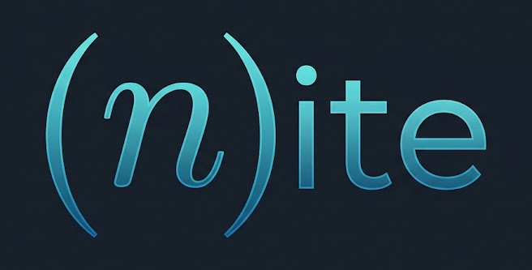

<p align="center">
  
</p>

# NiteFx documentation

The source of the [NiteFx](https://github.com/nite-net/nite) documentation site, built with
[DocFX](https://dotnet.github.io/docfx/) and published to GitHub Pages.

## Layout

```text
index.md                 the landing page
docs/                    introduction, getting started, tutorial, concepts, limits, troubleshooting
docs/guides/             task-oriented guides (SPAs, islands, packages, stylesheets, deployment…)
docs/reference/          CLI, nite.json, ASP.NET Core API, tag helpers, MSBuild, settings
api/index.md             the API reference landing page; the rest of api/ is generated
template/public/         theme overrides for DocFX's modern template (main.css, main.js)
images/                  logo, icon, favicons, social card
docfx.json               DocFX configuration
build.sh                 local build
.github/workflows/       build on every push and PR, deploy main to GitHub Pages
```

## Building locally

You need the .NET 10 SDK.

```bash
./build.sh           # build into _site/
./build.sh serve     # build, then serve on http://localhost:8080
```

The API reference is generated from the NiteFx source: `build.sh` clones
[nite-net/nite](https://github.com/nite-net/nite) into `nite-src/` the first time. To build
against a local checkout instead:

```bash
NITE_SRC=../nite ./build.sh serve
```

Builds treat warnings as errors, so a broken link or a missing page fails the build.

## Writing

- Pages are Markdown with [DocFX's extensions](https://dotnet.github.io/docfx/docs/markdown.html):
  alerts (`> [!NOTE]`, `> [!TIP]`, `> [!IMPORTANT]`), tabs, and `<xref:Nite.NiteOptions>` links
  to API types.
- Each folder's `toc.yml` defines its sidebar; the root `toc.yml` defines the top navigation.
- Link between pages with relative `.md` paths; DocFX checks them.
- Front matter sets the page `title` and `description` (used for search results and link previews).
  Quote values that contain a colon.
- Keep facts in step with the code. When in doubt, check the source or try it.

## Publishing

The workflow in `.github/workflows/pages.yml` builds on every push and pull request, and deploys
`main` to GitHub Pages. It also rebuilds daily (so the API reference follows NiteFx's `main`), on
manual dispatch, and when the NiteFx repository sends a `nite-updated` repository dispatch.

One-time setup in the repository settings: **Pages → Build and deployment → Source: GitHub Actions**.

## License

[Apache License 2.0](LICENSE), like NiteFx itself.
